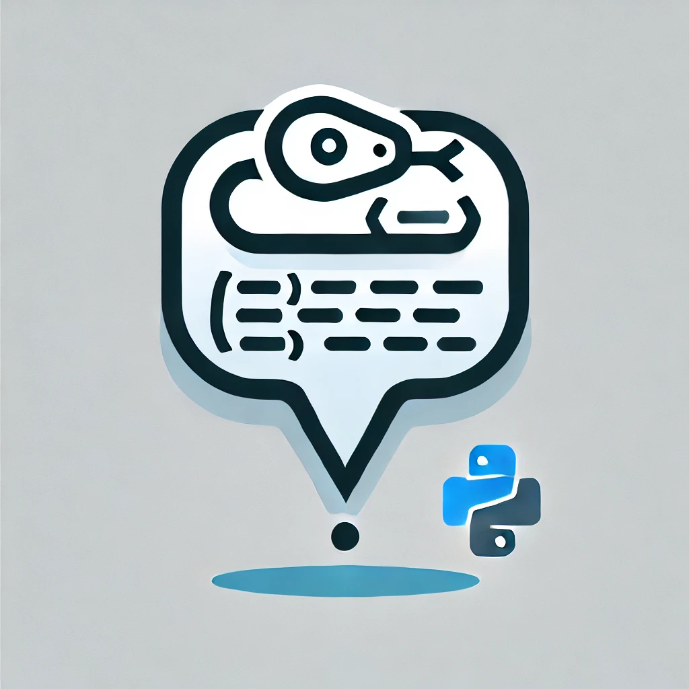

# AI Companion Bot



Telegram bot with AI characters. Users create a character, chat with it (OpenRouter),
and ask it for images (Runware). aiogram 3 over webhook, Postgres for state,
Redis for FSM, locks and quotas.

> This repository started from the [TgBotTemplate][tpl] scaffold. The README that
> came with it described features this project deliberately removed — most
> notably auto-generating and applying Alembic migrations at container start,
> which could emit `DROP COLUMN` against live data. Migrations are now an
> explicit one-shot job. See [docs/ARCHITECTURE.md](../docs/ARCHITECTURE.md).

[tpl]: https://github.com/say8hi/TgBotTemplate

## What it does

| Flow | Path | Cost |
|---|---|---|
| **Chat** | text → active profile + last 10 turns from Postgres → OpenRouter (`meta-llama/llama-3.3-70b-instruct`) → reply | 1 LLM call, ~5 s median |
| **Photo** | trigger word → profile → OpenRouter builds an SD prompt → Runware over websocket → image | 2 external calls, 10–40 s |

Plus a character-creation wizard (FSM), inline menus, ru/en, premium tiers and
an admin broadcast.

## Content policy

The bot is family-friendly by design, and this is enforced in code, not left to
the model's defaults:

* **Chat** — the system prompt (`tgbot/handlers/user.py`) keeps every reply
  suitable for all ages and limits the conversation to everyday topics such as
  hobbies, books, travel and food.
* **Images** — the prompt builder (`tgbot/services/image_prompts.py`) always
  keeps the character in the modest profile outfit and only describes everyday
  activities. Every image also passes Runware's built-in content check, and an
  image that fails it is discarded instead of delivered
  (`tgbot/services/runware.py`).
* **Customization** — outfits, locations and personalities are fixed lists of
  neutral options; users cannot type their own.

## Stack

Python 3.11 · aiogram 3.3 · SQLAlchemy 2 (asyncpg) · Alembic · Redis 7 ·
Postgres 16 · nginx · self-hosted Telegram Bot API server · Docker Compose

## Running it

```bash
cp .env.example .env
```

Fill in `.env`. Three values have no safe default and the stack will not work
without them:

| Variable | Why |
|---|---|
| `BOT_TOKEN` | from @BotFather |
| `WEBHOOK_SECRET` | **the bot refuses to start without it.** Anyone who learns the webhook URL can otherwise post updates claiming to be any user id, including an admin |
| `REDIS_PASSWORD` | compose passes it to `--requirepass`; empty means an unauthenticated Redis holding every session and quota counter |

Generate the two secrets:

```bash
python -c "import secrets; print(secrets.token_urlsafe(48))"
```

Then:

```bash
docker compose up -d --build
```

Startup order is enforced by compose: Postgres and Redis must pass their
healthchecks, the one-shot `migrations` job must exit 0, and nginx waits for the
bot's `/healthz` before accepting traffic.

Full pre-deploy checklist: [docs/DEPLOY.md](../docs/DEPLOY.md).

## Operating it

| Endpoint | Purpose |
|---|---|
| `GET /healthz` | 200 when Postgres and Redis both answer, 503 otherwise. Used as the container healthcheck |
| `GET /metrics` | `db_pool_checked_out` vs `db_pool_size`, `requests_shed_total`, free LLM/image slots |

Both are internal to the compose network — nginx does not expose them.

The two numbers worth alerting on: `db_pool_checked_out` approaching
`db_pool_size` (raise `DB_POOL_SIZE`), and `requests_shed_total` climbing (the
bot is refusing work; raise the concurrency ceilings, or add capacity).

## Capacity

Measured, not guessed — see [docs/LOAD_TEST.md](../docs/LOAD_TEST.md). Against
the 8 msg/s target the bot adds ~50 ms to the model's own latency, and no
breaking point was found up to 160 msg/s for returning users. The limit that
bites first is a **registration wave**: a first-time user is an INSERT the user
cache cannot absorb, and that is what `DB_POOL_SIZE` exists for.

## Development

```bash
pip install -e ".[dev]"
pytest -q
```

The suite needs no Postgres, no Redis, no Telegram and no `.env` — everything
external is faked in-process.

CI runs the tests, a blocking ruff pass (the rules that catch a botched
refactor, not style), an advisory mypy/format pass, a layering check that
forbids per-request HTTP and Redis clients, a check that the webhook secret is
still enforced, and a Docker build.

### Adding a handler

1. New file in `tgbot/handlers/`, create a `Router`.
2. Add it to `routers_list` in `tgbot/handlers/__init__.py` — **order matters**,
   specific to general, and `fallback_router` must stay last.
3. Any button you render must have a handler registered for its `callback_data`;
   `tests/routers/test_callback_coverage.py` enforces it.

### Changing the schema

Autogeneration is deliberately not wired up. Write the revision by hand:

```bash
alembic revision -m "what changed"
alembic upgrade head
```

## License

MIT
